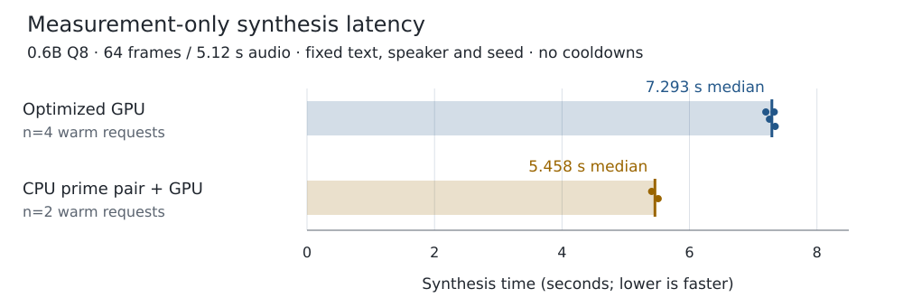
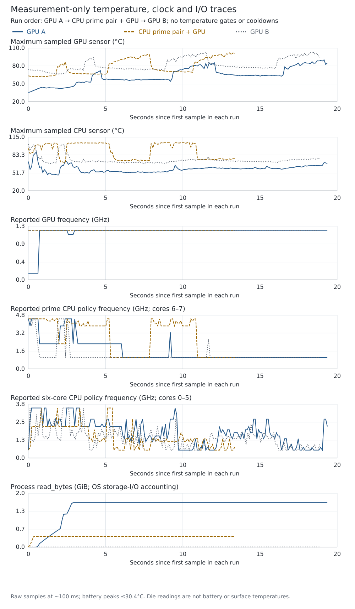

# Adreno 830 phone results

These are bounded measurements on a Samsung S25 Ultra, not a general device ranking or a sustained real-time claim. The final measurements use a corrected causal mask and finite, non-silent decoded float audio. Earlier silent fixtures were excluded from the validated comparisons.

## Measurement-only comparison

The latest protocol imposes no temperature aborts or cooldown waits. Two CPU threads on prime cores 6–7 generate codes while OpenCL decodes them. The optimized GPU control also enables the validated two-token kernel. All processes use the same paragraph, speaker conditioning, English, temperature 0.9 for both stages, and seed 20261026 reset per request. A sixteen-frame warmup precedes two sixty-four-frame requests per process. Order is GPU A → hybrid → GPU B. Every measured clip is 5.12 seconds; all recorded scheduling states are `/top-app`.



| Profile | Warm requests | Generation median | Decoder median | Total median |
|---|---:|---:|---:|---:|
| Optimized GPU A/B | 4 | 4,399.0 ms | 2,858.0 ms | 7,292.5 ms |
| Prime CPU pair + GPU | 2 | 2,634.5 ms | 2,822.5 ms | 5,458.0 ms |

This is 25.16% less synthesis time, or 1.336× throughput at this fixed output length. Individual totals are GPU 7,330/7,255/7,345/7,198 ms and hybrid 5,407/5,509 ms. The hybrid still took slightly longer than real time. Different backends generated different seeded speech codes; finite non-silent audio is not proof of equal perceived quality. Private listening clips and raw code arrays remain in the local research workspace.



| Block | GPU sensor maximum | CPU sensor maximum | Battery maximum |
|---|---:|---:|---:|
| GPU A | 90.3°C | 88.8°C | 29.6°C |
| Hybrid | 101.9°C | 105.4°C | 30.4°C |
| GPU B | 103.8°C | 102.7°C | 30.4°C |

Die readings are not battery/surface temperatures. Frequency is a sampled sysfs report, not clock residency or duty-cycle measurement. Starting thermal and OS file-cache states differ, so this sequence does not establish a thermal/energy winner. There are few trials and no confidence interval or statistical significance claim. Component medians need not sum to the median total.

The reviewed rows are in [results.json](results.json), [summary-measurement-only.json](summary-measurement-only.json), and [telemetry.csv](telemetry.csv). Recompute the retained comparisons without running inference:

```sh
python docs/performance/adreno830/verify_results.py
```

## Correctness correction

The old fast `DIAG_MASK_INF` shader indexed `float4` pointers as scalar components, writing neighbouring vectors and outside the tensor. It failed 13 of 15 causal-mask cases and corrupted guards in 11. The bounded-vector replacement passed all 15. The regression harness and historical negative fixture live in the GGML fork under `tests/opencl/`.

On one saved code sequence the old GPU decoder produced 15,360 non-finite samples while CPU decoding was finite. The fixed GPU decoder was finite on every sample, with maximum absolute CPU difference 0.0011644 and RMSE 0.00010254. Earlier short 0.6B greedy WAV hashes matched encoded silence and did not validate speech. Those exploratory results are not the basis of the table above.

## Startup and small kernels

The opt-in program-binary cache reduced one same-route process-readiness observation from 9.33 to 2.91 seconds. An earlier conditioned hybrid profile became ready in 1.61 seconds against 9.13/11.24 seconds for uncached GPU controls. In the latest all-cached sequence readiness was 3.01/2.51 seconds on GPU and 1.21 seconds on hybrid. These are individual observations with different cache/placement conditions; first-install startup still includes compilation.

In an earlier twelve-frame comparison, the final two-token GPU kernel preserved saved codes and PCM exactly and reduced median synthesis time 1,418.5 → 1,358.5 ms (4.2%). A faster F32-input prototype changed output and was rejected. The selected FP16-texture kernel matched twenty paired matrix cases across four shapes. The backend option is still explicitly gated.

The 1.7B screen did not justify copying the 0.6B CPU profile. Repeated seeded GPU requests varied between two observed outputs, so that screen does not prove bit-exact small-kernel parity. Its launcher keeps the conservative GPU path and leaves the extra kernel disabled.

## Memory, storage and failed ideas

OpenCL reported twelve compute units, unified memory, 32 KiB local memory, 64-byte cache lines and a 1 GiB maximum allocation. Its cache-size query is not treated as a full physical cache-topology description.

A vector-copy probe measured effective aggregate read+write traffic of 72.9/68.3/66.8 GB/s for 8/32/128 MiB buffers. A read-only aligned `O_DIRECT` test of the first 256 MiB of the GGUF measured 3.25–3.56 GB/s. Repeated buffered reads reached 10.20–10.82 GB/s. These are access-path measurements, not raw NAND or manufacturer peak specifications; no global cache flush was used. Startup is therefore not attributed to flash alone. Warm synthesis showed little additional storage I/O.

Subgroup-count tuning was shape-dependent; there is no blanket replacement. Persistent Q8 weight-image views did not establish an improvement. QCOM recordings improved a tiny-kernel synthetic sequence by roughly threefold but the generic graph-cache prototype did not establish an end-to-end TTS win. It remains disabled in profiles.

Two corrected two-utterance pipeline trials preserved codes and float audio exactly and improved throughput by 13–16%; later work reached the then-active thermal trigger. This is not a single-utterance latency improvement or a sustained result. No pipeline mode is enabled by the launchers.

The recorded microbench rows are in [microbench-results.json](microbench-results.json). Further precision changes, prepacked weight caches, fused predictor execution and stateful streaming need their own numerical, listening and lifetime controls. Microkernel ratios cannot be multiplied into the end-to-end result.

## NPU and validation scope

See [NPU feasibility and firsthand Termux examples](../../NPU_ASSESSMENT.md). No NPU calculation has been executed by this project yet. Direct device-node denials do not rule out the vendor-broker route used by the S24 Ultra reference.

The source is published from the tested core files and exported patches. Local syntax/metadata checks are separate from hardware execution; a fresh source build and rerun must retain its own results. Models, reference voices, generated WAVs, raw speech-code arrays, program caches and compiled binaries are not included in Git. The original research artifacts and frozen controls remain local.
